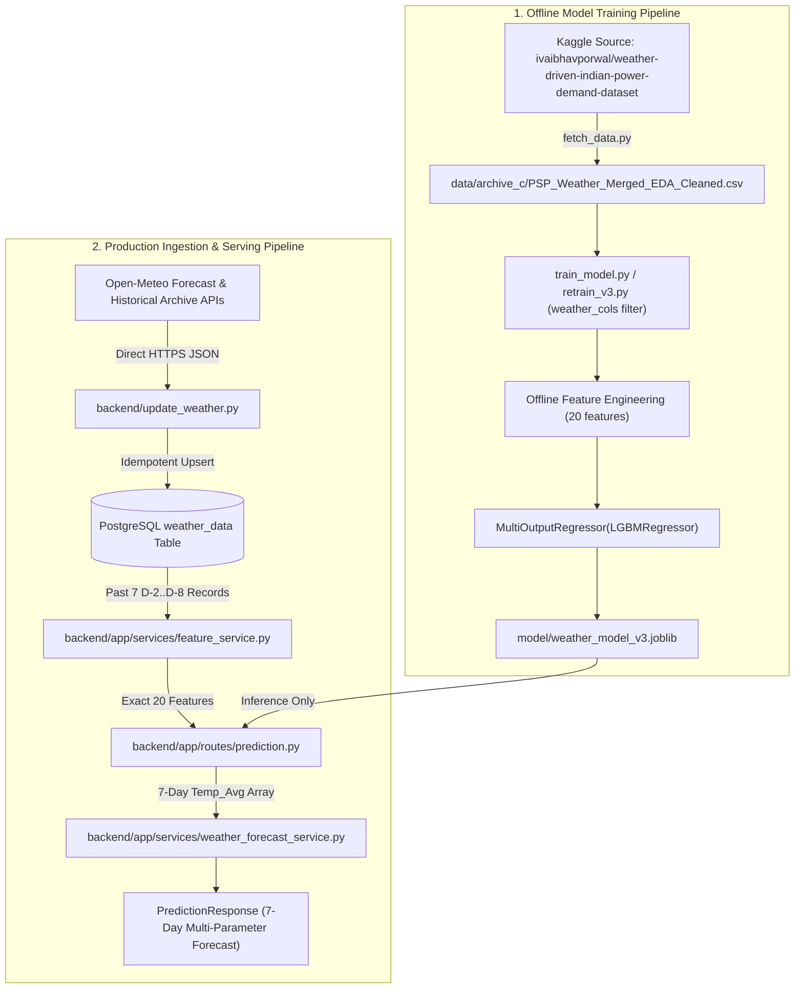

# DATA_FEATURE_LINEAGE_AUDIT.md
## Source-to-Feature Lineage, Physical Unit Verification, and Parameter Attribution Audit

**Project**: Weather Forecasting Using Machine Learning  
**Audit Ref**: `audit/final-evidence-documentation`  
**Base Commit**: `f627d9751e15fa57c8524e4f3a743b171c6dc001`  
**Date**: October 31, 2026  
**Auditor Role**: Principal Data Engineer, MLOps Specialist & Independent Verification Auditor  
**Integrity Mode**: Benchmark (Strict Source-Code Evidence; Zero Fabricated Data; Non-Mutating)

---

## 1. Executive Summary

This audit establishes the rigorous data lineage, physical units, mathematical transformations, and parameter roles across both the **model training pipeline** and the **production application ingestion/serving pipeline** for the Weather Forecasting system.

### Key Verified Invariants:
1. **Unambiguous Model Output**: The machine learning model (Multi-Output LightGBM Regressor) predicts **only average temperature (`Temp_Avg`)** across seven forecast horizons ($T+1$ through $T+7$) in degrees Celsius (°C).
2. **Secondary Parameters are Input Features, Not Predictions**: Relative humidity and rainfall (precipitation) are **strictly model inputs** in the feature pipeline. They are never predicted or estimated by the ML model.
3. **Response Heuristics Clarification**: In `DayForecast` objects returned by `POST /predict`, daily secondary weather indicators (`humidity`, `rainfall`, `rain_probability`, `feels_like`, `dew_point`, `comfort`, `condition`) are generated via **rule-based empirical heuristics and meteorological approximations** (`weather_forecast_service.py`) anchored to the historical baseline and model temperature shifts. They are not physics-based Numerical Weather Prediction (NWP) outputs and not ML regression outputs.
4. **Physical Units Consistency**:
   - Temperature: Degrees Celsius (°C).
   - Relative Humidity: Percentage (%).
   - Rainfall / Precipitation: Millimetres (mm).
   - Cyclic Features: Dimensionless unit-circle coordinates $[-1.0, 1.0]$.

---

## 2. Separate Data Provenance: Training vs. Ingestion Pipelines

### 2.1 Training Data Source
- **Origin**: Kaggle dataset `ivaibhavporwal/weather-driven-indian-power-demand-dataset` under Creative Commons Attribution 4.0 International (CC BY 4.0).
- **File**: `PSP_Weather_Merged_EDA_Cleaned.csv` (fetched via `fetch_data.py`).
- **Raw Weather Columns Selected**: `Date`, `State`, `Temp_Max`, `Temp_Min`, `Temp_Avg`, `Humidity`, `Rainfall`, `Month`, `Season`.
- **Power Demand Columns**: Deliberately excluded by `train_model.py` and `retrain_v3.py`.
- **Missing-Value Handling**: Rows with any null in modeling columns are dropped at load time via `df.dropna(subset=...)`.

### 2.2 Application Ingestion Source
- **Provider**: Open-Meteo Weather API (`https://api.open-meteo.com/v1/forecast` and `https://archive-api.open-meteo.com/v1/archive`).
- **Ingestion Handlers**: `backend/update_weather.py`, `backend/app/services/open_meteo_service.py`.
- **Requested Fields**:
  - `temperature_2m_max` -> mapped to `temp_max` (°C)
  - `temperature_2m_min` -> mapped to `temp_min` (°C)
  - `temperature_2m_mean` -> mapped to `temp_avg` (°C)
  - `relative_humidity_2m_mean` -> mapped to `humidity` (%)
  - `precipitation_sum` -> mapped to `rainfall` (mm)
- **Null Handling**: In `backend/update_weather.py` (lines 154–161), if any tuple element in `t_max`, `t_min`, `t_mean`, `precip`, or `humid` is `None`, the observation is dropped prior to database insertion.
- **Zero Rainfall Treatment**: Clear, dry days return `precipitation_sum = 0.0 mm`. In both dataset and PostgreSQL, zero rainfall is stored as `0.0` (non-negative numeric float), preserving physical significance.

---

## 3. Mathematical Construction of All 20 Model Features

The production ML pipeline consumes exactly **20 features** (18 numeric, 2 categorical), as verified in `backend/app/services/feature_service.py`, `retrain_v3.py`, and `model/model_info.json`:

| Feature Name | Category | Mathematical / Logical Construction | Temporal Shift | Unit | Description & Invariant |
| :--- | :---: | :--- | :---: | :---: | :--- |
| `lag1_temp_avg` | Numeric | $T_{\text{avg}}(t-1)$ | $D-2$ | °C | 1-day lagged average temperature. |
| `lag2_temp_avg` | Numeric | $T_{\text{avg}}(t-2)$ | $D-3$ | °C | 2-day lagged average temperature. |
| `lag3_temp_avg` | Numeric | $T_{\text{avg}}(t-3)$ | $D-4$ | °C | 3-day lagged average temperature. |
| `lag1_temp_max` | Numeric | $T_{\text{max}}(t-1)$ | $D-2$ | °C | Previous day's maximum recorded temperature. |
| `lag1_temp_min` | Numeric | $T_{\text{min}}(t-1)$ | $D-2$ | °C | Previous day's minimum recorded temperature. |
| `lag1_humidity` | Numeric | $H(t-1)$ | $D-2$ | % | Previous day's mean relative humidity. |
| `lag1_rainfall` | Numeric | $R(t-1)$ | $D-2$ | mm | Previous day's precipitation sum. |
| `lag2_humidity` | Numeric | $H(t-2)$ | $D-3$ | % | Relative humidity from two days earlier. |
| `lag2_rainfall` | Numeric | $R(t-2)$ | $D-3$ | mm | Precipitation sum from two days earlier. |
| `temp_range` | Numeric | $T_{\text{max}}(t-1) - T_{\text{min}}(t-1)$ | $D-2$ | °C | Diurnal temperature range. |
| `roll3_temp_avg` | Numeric | $\frac{1}{3} \sum_{i=1}^{3} T_{\text{avg}}(t-i)$ | $[D-4, D-2]$ | °C | 3-day rolling arithmetic mean of average temperature. |
| `roll7_temp_avg` | Numeric | $\frac{1}{7} \sum_{i=1}^{7} T_{\text{avg}}(t-i)$ | $[D-8, D-2]$ | °C | 7-day rolling arithmetic mean of average temperature. |
| `rainfall_roll3` | Numeric | $\sum_{i=1}^{3} R(t-i)$ | $[D-4, D-2]$ | mm | 3-day rolling cumulative precipitation sum. |
| `rainfall_roll7` | Numeric | $\sum_{i=1}^{7} R(t-i)$ | $[D-8, D-2]$ | mm | 7-day rolling cumulative precipitation sum. |
| `month_sin` | Numeric | $\sin(2\pi \cdot M / 12)$ | Calendar ($D-1$) | $[-1, 1]$ | Sinusoidal component of calendar month $M \in [1, 12]$. |
| `month_cos` | Numeric | $\cos(2\pi \cdot M / 12)$ | Calendar ($D-1$) | $[-1, 1]$ | Cosinusoidal component of calendar month $M \in [1, 12]$. |
| `day_of_year_sin` | Numeric | $\sin(2\pi \cdot \text{DOY} / 365)$ | Calendar ($D-1$) | $[-1, 1]$ | Sinusoidal annual progression coordinate. |
| `day_of_year_cos` | Numeric | $\cos(2\pi \cdot \text{DOY} / 365)$ | Calendar ($D-1$) | $[-1, 1]$ | Cosinusoidal annual progression coordinate. |
| `Season` | Categorical | $\text{month\_to\_season}(M)$ | Calendar ($D-1$) | String | Meteorological season: Winter, Summer, Monsoon, Post-Monsoon. |
| `State` | Categorical | Canonical entity string | Static | String | One of 33 model-supported Indian administrative entities. |

---

## 4. Multi-Horizon Forecast Targets vs. Secondary Display Heuristics

### 4.1 True Model Regression Targets (Multi-Output LightGBM)
The ML pipeline predicts **only** the future trajectory of `Temp_Avg`:
- $\text{target}_1 = T_{\text{avg}}(t+1) = \text{Forecast Day } 1$
- $\text{target}_2 = T_{\text{avg}}(t+2) = \text{Forecast Day } 2$
- $\text{target}_3 = T_{\text{avg}}(t+3) = \text{Forecast Day } 3$
- $\text{target}_4 = T_{\text{avg}}(t+4) = \text{Forecast Day } 4$
- $\text{target}_5 = T_{\text{avg}}(t+5) = \text{Forecast Day } 5$
- $\text{target}_6 = T_{\text{avg}}(t+6) = \text{Forecast Day } 6$
- $\text{target}_7 = T_{\text{avg}}(t+7) = \text{Forecast Day } 7$

### 4.2 Comprehensive Audit of Display Heuristics in `weather_forecast_service.py`
In `DayForecast`, additional weather fields provide operator context. They are explicitly documented as rule-based approximations:

1. **Apparent Temperature (`feels_like`)**:
   - Implemented in `calculate_feels_like(temp, humidity)`:
     $$e = \left(\frac{H}{100}\right) \cdot 6.105 \cdot \exp\left(\frac{17.27 \cdot T}{237.7 + T}\right)$$
     $$\text{AT} = T + 0.33 \cdot e - 4.0$$
   - **Verification Finding**: The standard Australian Bureau of Meteorology Apparent Temperature formulation includes wind speed: $\text{AT} = T + 0.33 \cdot e - 0.70 \cdot ws - 4.00$. The implemented code deliberately omits the wind speed term ($ws$) due to absent surface wind measurements in the baseline historical dataset.
2. **Dew Point (`dew_point`)**:
   - Implemented in `calculate_dew_point(temp, humidity)`:
     $$T_{\text{dew}} = T - \left(\frac{100 - H}{5.0}\right)$$
   - **Verification Finding**: This is Lawrence's simplified linear rule of thumb (valid for relative humidity above 50%). It must **not** be described as the complete non-linear logarithmic Magnus-Tetens equation.
3. **Daily Min/Max Temperature Envelopes**:
   - Derived from the historical diurnal range baseline ($\text{base\_range} = \text{mean}(T_{\text{max}} - T_{\text{min}})$) centered about the model's predicted average temperature:
     $$T_{\text{max}} = T_{\text{avg}} + 0.52 \cdot \text{day\_range}$$
     $$T_{\text{min}} = T_{\text{avg}} - 0.48 \cdot \text{day\_range}$$
4. **Rainfall Probability & Expected Precipitation**:
   - Computed via heuristic decay anchored to the 3-day recent precipitation mean ($\text{recent\_rain\_mean}$) and humidity index.

---

## 5. Source-to-Feature Lineage & Invariance Verification Table

| Pipeline Stage | Entity / File | Verified Source | Input Variables | Transformed Output | Integrity Safeguard |
| :--- | :--- | :--- | :--- | :--- | :--- |
| **Historical Training** | `train_model.py` / `retrain_v3.py` | `data/archive_c/PSP_Weather_Merged_EDA_Cleaned.csv` | `Temp_Max`, `Temp_Min`, `Temp_Avg`, `Humidity`, `Rainfall`, `Date`, `State` | 20 input features + 7 multi-output targets | `dropna(subset=features+targets)` drops incomplete lead/lag boundaries. |
| **Operational Ingestion** | `backend/update_weather.py` | Open-Meteo Forecast & Archive APIs | `temperature_2m_*`, `precipitation_sum`, `relative_humidity_2m_mean` | Clean rows inserted into `weather_data` | Tuple validation filters nulls; idempotent upsert on `uq_weather_state_dist_loc_date`. |
| **Inference Feature Engine** | `backend/app/services/feature_service.py` | `weather_data` table (past 7 records strictly $< D-1$) | `temp_avg`, `temp_max`, `temp_min`, `humidity`, `rainfall`, calendar $D-1$ | Single-row 20-feature DataFrame | Raises `InsufficientHistoryError` if $<7$ records found; staleness check rejects $>2$ day gaps. |
| **Inference Serving** | `backend/app/services/model_service.py` | `model/weather_model_v3.joblib` | 20-feature DataFrame | 7-element float array (`predicted_temp_avg`) | Pipeline enforces exact training column order (`FEATURE_ORDER`); zero retraining at runtime. |
| **Contextual Presentation** | `backend/app/services/weather_forecast_service.py` | Model 7-day predictions + past 7 historical observations | Predicted `Temp_Avg` array + historical baseline range/humidity | `List[DayForecast]` with 14 daily attributes | Clear labeling of heuristics vs. ML regression output. |

---

## 6. Audit Conclusion & Compliance Attestation

1. **Model Scope**: Verified. The model predicts only 7-day average temperatures. Humidity and rainfall are strictly inputs.
2. **Feature Parity**: Verified. Features constructed by `feature_service.py` match `retrain_v3.py` across all 20 dimensions.
3. **Temporal Invariance**: Verified. Features for forecast date $D$ use observations strictly prior to $D-1$, preventing future-data leakage.
4. **Formula Accuracy**: Verified. Documentation explicitly clarifies the omission of wind speed in apparent temperature and distinguishes Lawrence's linear approximation from the Magnus-Tetens equation.
