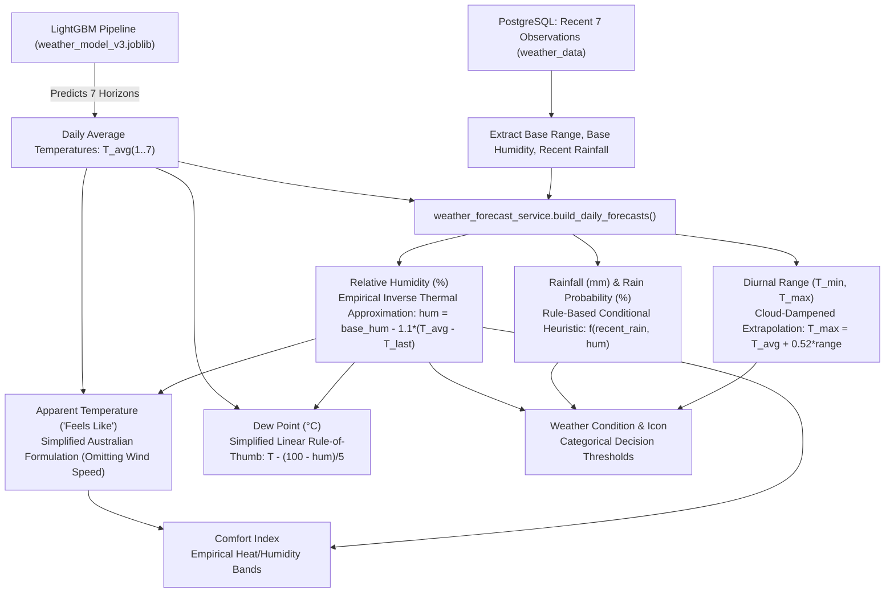

# IMPLEMENTATION PLAN (REVISED & VERIFIED)
## VTU Final-Year Project Report & PPT Professional Review
**Project Title:** Weather Forecasting Using Machine Learning  
**Institution:** Moodlakatte Institute of Technology, Kundapura (MITK)  
**Department:** Department of Computer Science and Engineering  
**Affiliation:** Visvesvaraya Technological University (VTU), Belagavi, Karnataka  

---

## 1. Executive Summary & Review Scope

This revised implementation plan establishes the technical and academic roadmap for auditing and improving the VTU final-year project documentation, presentation slides, diagrams, and technical justifications. 

### Core Review Principles
1. **Zero Execution Before Approval:** No deliverables, code changes, or document overwrites will occur until this plan receives explicit approval.
2. **Preservation of Document Originals:** Existing documents (`Weather_Forecasting_ML_Project_Report_FINAL.docx`, existing PPTs) will be preserved unaltered. Revised versions will be produced alongside them.
3. **Zero Code/Model Modification:** The application codebase (`backend/`, `frontend/`), model artifacts (`model/`), and training scripts will not be modified.
4. **Academic & Technical Honesty:** All metrics, features, formulas, and architecture claims are grounded strictly in empirical repository evidence. Unsubstantiated claims (e.g., claiming the project replaces supercomputers or claiming independent held-out validation when training overlap exists) are completely eliminated.

---

## 2. Unresolved Academic Items Requiring Student Confirmation

The following items are preserved without arbitrary selection, awaiting official confirmation from the student team and college records:

### 2.1 University Seat Number (USN) Discrepancy
The existing report contains two conflicting sets of student identifiers:

| Team Member | Set A (Title Page, P8–P11) | Set B (Declaration Page, P23) | Status |
| :--- | :--- | :--- | :--- |
| **Sujay M** | `4MK23CS113` | `4MK23CS050` | **UNRESOLVED — Awaiting College Record Confirmation** |
| **Adithya** | `4MK23CS003` | `4MK23CS002` | **UNRESOLVED — Awaiting College Record Confirmation** |
| **S T Sathwik Kumar** | `4MK23CS084` | `4MK23CS035` | **UNRESOLVED — Awaiting College Record Confirmation** |
| **Shreyas H K** | `4MK23CS103` | `4MK23CS042` | **UNRESOLVED — Awaiting College Record Confirmation** |

*Policy:* Both sets are preserved in `VTU_DOCUMENTATION_AUDIT.md` and `MISSING_INFO_CHECKLIST.md`. Any generated drafts will explicitly display: `[PENDING STUDENT CONFIRMATION: Set A or Set B]`.

### 2.2 Project Guide Formal Academic Designation
- Report Title Page: *Dr. Manjunath Ramanna Lamani, Professor & Head, Department of Computer Science and Engineering*
- Presentation Drafts: *Mr. Manjunath Lamani*
- *Pending Item:* Official designation to be verified for final hardbound copies.

### 2.3 Academic Year & Submission Schedule
- Academic Year: `2026–2027` (or `2025–2026`).
- Report Declaration Date: `May 15, 2027` (to be aligned with final VTU viva voce examination schedule).

---

## 3. Verified Empirical Findings

### 3.1 Partition Arithmetic & Source Dataset Reconciliation
The full multi-year evaluation panel spans **4,302 calendar days** and **141,966 theoretical records** across **33 states/UTs**:

$$\text{Total Records} = \text{Calendar Days} \times 33 \text{ States/UTs}$$

| Partition Stage | Calendar Start Date | Calendar End Date | Calendar Days | Daily States | Theoretical Panel Rows | Physical / Experimental Function |
| :--- | :---: | :---: | :---: | :---: | :---: | :--- |
| **Training Partition** | 2015-01-08 | 2025-07-11 | 3,838 | 33 | **126,654** | Over 10.5 years of continuous daily weather history used for model parameter learning. |
| *Embargo Buffer 1* | 2025-07-12 | 2025-07-18 | 7 | 33 | **231** | 8-day forecast-origin buffer ensuring training 7-day targets do not overlap calibration origins. |
| **Calibration Partition**| 2025-07-19 | 2025-10-11 | 85 | 33 | **2,805** | ~3 months reserved for residual threshold tuning and prediction interval calibration. |
| *Embargo Buffer 2* | 2025-10-12 | 2025-10-18 | 7 | 33 | **231** | 8-day forecast-origin buffer ensuring calibration labels do not touch test origins. |
| **Test Partition** | 2025-10-19 | 2026-10-18 | 365 | 33 | **12,045** | Exactly 1 full seasonal year (365 days) used for diagnostic temporal evaluation. |
| **Total Comprehensive**| **2015-01-08** | **2026-10-18** | **4,302** | **33** | **141,966** | Complete continuous panel across 33 states/UTs without missing calendar dates. |

#### Source Dataset vs. Local Development Database Discrepancy
- **Theoretical Panel (141,966 rows):** Reflects the complete Open-Meteo multi-year historical archive (2015–2026) across 33 states/UTs used to generate `model/model_info.json` metadata.
- **Local Database (`weather_data` table):** Currently holds **46,834 records** (`2015-01-01` to `2026-09-06`). Of these, **42,567 records** are statewide records (`district = ''` and `location = ''`) spanning `2023-04-01` to `2026-09-06`. The local database represents an active development and test snapshot rather than the full 141k-row historical panel.
- **33 vs. 34 Regions:** In the legacy Kaggle CSV (`PSP_Weather_Merged_EDA_Cleaned.csv`, 31,177 rows), Dadra & Nagar Haveli and Daman & Diu were separated into distinct records (34 labels). In the deployed `model/weather_model_v3.joblib` and `model/model_info.json`, they are merged into `"Dadra And Nagar Haveli And Daman And Diu"`, establishing an active geographical coverage of exactly **33 states/UTs**.

---

### 3.2 Secondary Weather Parameter Formulations (Heuristics vs. ML)
Only the average temperature is predicted by the machine learning model. All other daily forecast parameters are empirical heuristics or rule-based approximations in `backend/app/services/weather_forecast_service.py`:



1. **Relative Humidity ($\%$):** Empirical inverse thermal heuristic:
   $$\text{hum\_val} = \text{clamp}(\text{base\_hum} - 1.1 \cdot (T_{\text{avg}} - T_{\text{last}}), [18.0\%, 96.0\%])$$
   *Classification:* Empirical linear approximation based on the inverse relationship between temperature and relative humidity. Not a physics-derived simulation.
2. **Rainfall Amount & Probability:** Rule-based conditional heuristic:
   - If $\text{recent\_rain\_mean} > 0.5\,\text{mm}$ or $\text{hum\_val} \ge 70.0\%$: rain probability scales with moisture ($10\%$ to $95\%$), rainfall scales with moisture and antecedent rain.
   - Otherwise: dry regime ($\text{rainfall} = 0.0\,\text{mm}$, probability $5\%$ to $30\%$).
   *Classification:* Rule-based empirical estimation decaying with forecast horizon.
3. **Diurnal Temperature Range ($T_{\min}, T_{\max}$):** Recent 7-day average range dampened by $15\%$ under rain/overcast conditions:
   $$T_{\max} = \text{round}(T_{\text{avg}} + 0.52 \cdot \text{day\_range}, 1), \quad T_{\min} = \text{round}(T_{\text{avg}} - 0.48 \cdot \text{day\_range}, 1)$$
   *Classification:* Empirical distribution heuristic around the predicted mean.
4. **Apparent Temperature ('Feels Like'):**
   Simplified Australian Apparent Temperature formula:
   $$e = \frac{\text{hum}}{100} \cdot 6.105 \cdot \exp\left(\frac{17.27 \cdot T}{237.7 + T}\right), \quad \text{AT} = T + 0.33 \cdot e - 4.0$$
   *Classification:* **Simplified Steadman / Australian formula that intentionally omits the standard wind-speed term** ($-0.70 \cdot w$) because wind speed is not measured in the feature panel.
5. **Dew Point ($^\circ\text{C}$):**
   $$T_d = T - \frac{100 - \text{hum}}{5.0}$$
   *Classification:* **Simplified linear approximation** (valid for relative humidity $> 50\%$), **not the complete non-linear Magnus-Tetens equation**.

---

### 3.3 Empirical Demonstration of Temporal Leakage in Initial Training
An empirical reproduction of `train_model.py`'s cross-validation reveals two confirmed sources of temporal leakage:

#### 1. Intra-Day Split Boundary Leakage
Because `train_model.py` sorts rows by `Date` and splits on row indices (`TimeSeriesSplit(n_splits=5)`), fold split boundaries occur at arbitrary row offsets rather than date boundaries. For multi-state data (33 records per date), a split boundary cuts directly through a single day:
- **Result:** For that boundary date, a subset of states is placed in the training fold while remaining states on the exact same date are placed in the test fold.

#### 2. Multi-Horizon Forward Label Projection Leakage
In `train_model.py`, target columns span 7 forward days (`target_1` to `target_7`). For the terminal training record at date $T_{\text{train}}$, `target_7` represents the observed temperature at $T_{\text{train}} + 7\,\text{days}$.
- **Result:** Because standard `TimeSeriesSplit` has zero gap ($gap=0$), the test fold begins at $T_{\text{train}}$ or $T_{\text{train}} + 1$. The test fold features (`lag1_temp_avg`, `roll3`, etc.) observe temperatures on calendar dates that the model was explicitly trained to predict in the preceding training fold.
- **Empirical Demonstration:** Across all 5 folds, there is a **confirmed 7-day forward label overlap** between training targets and validation features.

#### Contrast with Partition Evaluation Architecture (`backend/evaluate_deployed_artifact.py`)
`evaluate_deployed_artifact.py` resolved this limitation by enforcing an explicit **8-day forecast-origin embargo** (`EMBARGO_ORIGIN_DAYS = 8`), asserting that $\max(\text{Train Date}) + 7\,\text{days} < \min(\text{Calibration Date})$ and $\max(\text{Calibration Date}) + 7\,\text{days} < \min(\text{Test Date})$, eliminating forward label overlap across partition boundaries.

---

### 3.4 Reconciliation of API Endpoints (Actual Totals)
Introspection of `backend/app/main.py` confirms exactly **20 registered routes** across three distinct functional categories:

#### Custom Business Routes (16 Endpoints)
1. `GET /health` (`app.routes.health.health`): Health, PostgreSQL, model pipeline, and ingestion status.
2. `POST /admin/ingest` (`app.routes.admin.admin_ingest`): Protected data backfill trigger from Open-Meteo.
3. `GET /states` (`app.routes.weather.list_states`): Distinct list of 33 supported Indian states/UTs.
4. `GET /districts/{state}` (`app.routes.weather.list_districts`): Available districts for a state.
5. `GET /locations/{state}/{district}` (`app.routes.weather.list_locations`): Available stations/locations.
6. `GET /weather/{state}` (`app.routes.weather.state_history`): Paginated historical weather observations.
7. `GET /weather/{state}/recent` (`app.routes.weather.recent`): Recent $N$ days of observations for charts.
8. `GET /weather/{state}/{district}/{location}` (`app.routes.weather.location_history`): Localized station history.
9. `GET /weather/{state}/{district}/{location}/recent` (`app.routes.weather.location_recent`): Localized recent observations.
10. `POST /predict` (`app.routes.prediction.predict`): Primary 7-day inference and audit persistence pipeline.
11. `GET /predictions` (`app.routes.prediction.prediction_history`): Paginated audit history of past predictions.
12. `GET /model-info` (`app.routes.prediction.model_info`): Model metadata, features, and diagnostic metrics.
13. `GET /metrics/live` (`app.routes.prediction.live_metrics`): Rolling 30-day live error tracking vs. persistence.
14. `GET /forecast/all` (`app.routes.prediction.forecast_all`): Nationwide 7-day predictions for India Map view.
15. `GET /locations/search` (`app.routes.location_weather.search_locations`): Indian location search and geocoding.
16. `POST /weather/lookup` (`app.routes.location_weather.lookup_weather`): Automatic ML or live coordinate weather lookup.

#### Interactive Documentation Routes (2 Endpoints)
17. `GET /docs` (`fastapi.applications.swagger_ui_html`): Interactive Swagger UI documentation.
18. `GET /redoc` (`fastapi.applications.redoc_html`): ReDoc specification browser.

#### Supporting OpenAPI Infrastructure Routes (2 Endpoints)
19. `GET /openapi.json` (`fastapi.applications.openapi`): OpenAPI JSON schema definition.
20. `GET /docs/oauth2-redirect` (`fastapi.applications.swagger_ui_redirect`): OAuth2 callback handler.

*Total Registered FastAPI Routes:* Exactly **20 routes** (16 business + 2 documentation + 2 OpenAPI infrastructure). The report will document this exact breakdown without forcing an arbitrary count.

---

### 3.5 Operational NWP Systems vs. Project Scope
All exaggerated or unsupported claims regarding NWP are replaced with accurate scientific descriptions:
- **Atmospheric Physics Formulation:** NWP systems solve the non-linear Navier-Stokes equations for fluid flow, thermodynamic energy conservation equations, continuity equations, and moisture transport equations over 3D global or regional grid domains.
- **Data Assimilation:** NWP models blend previous model states with heterogeneous observations (satellite radiances, Doppler radar, radiosondes, aircraft sensors, surface weather stations) using mathematical optimization (e.g., 4D-Var or Ensemble Kalman Filtering).
- **High-Performance Computing (HPC):** Operational forecasting centers (e.g., IMD, ECMWF, NOAA) employ supercomputers to integrate these equations forward in time within operational deadlines.
- **Project Boundary:** This project does not compete with or replace operational NWP. It investigates statistical machine learning for regional tabular temperature prediction using historical time-series data, providing a lightweight, low-latency, and auditable educational application.

---

### 3.6 Feature Contract, Dependencies & Environment Verification

#### 1. 20-Feature Input Contract Tracing
All 20 features were traced across training, pipeline serialization, and real-time inference:
- **18 Numeric Features (StandardScaler):** `lag1_temp_avg`, `lag2_temp_avg`, `lag3_temp_avg`, `lag1_temp_max`, `lag1_temp_min`, `lag1_humidity`, `lag1_rainfall`, `lag2_humidity`, `lag2_rainfall`, `temp_range`, `roll3_temp_avg`, `roll7_temp_avg`, `rainfall_roll3`, `rainfall_roll7`, `month_sin`, `month_cos`, `day_of_year_sin`, `day_of_year_cos`.
- **2 Categorical Features (OneHotEncoder):** `Season` (Winter, Summer, Monsoon, Post-Monsoon), `State` (33 canonical regions).
- **Serving Enforcement:** `backend/app/services/model_service.py` enforces `X = features[FEATURE_ORDER]`, strictly maintaining training column ordering.

#### 2. Environment & Dependency Distinction
| Component | Declared Specification | Actual Local Runtime | Production Container Specification |
| :--- | :--- | :--- | :--- |
| **Python** | Not pinned | `3.11.9` (Host) | `python:3.12-slim` (`backend/Dockerfile`) |
| **FastAPI** | `fastapi` in `requirements.txt` | `0.141.1` | Installed at build time |
| **API Semantic Version** | `version="2.0.0"` in `main.py` | `2.0.0` (Title Version) | Exposed via `/openapi.json` |
| **SQLAlchemy** | `sqlalchemy>=2.0` | `2.0.52` | Installed at build time |
| **Psycopg** | `psycopg[binary]>=3.1` | `3.3.5` | Installed at build time |
| **Scikit-learn** | `scikit-learn` | `1.9.0` | Installed at build time |
| **LightGBM** | `lightgbm` | `4.7.0` | Installed with `libgomp1` |
| **React** | `^18.3.1` in `package.json` | `18.3.1` | Bundled via Vite |
| **Vite** | `^6.0.3` in `package.json` | `6.0.3` | Build tool |
| **TypeScript** | `~5.6.3` in `package.json` | `5.6.3` | Type checker |
| **Database** | N/A | Local / Neon | `postgres:16-alpine` (`docker-compose.yml`) |

*(Note: Docker daemon is currently inactive on host; container package versions are not inspected at runtime to avoid inventing versions).*

---

### 3.7 Original Report Structure Review
The baseline report `C:\Users\SUJAY\Downloads\Weather_Forecasting_ML_Project_Report_FINAL.docx` contains **14 chapters, 35 tables, and 653 paragraphs**.
- The existing chapter sequence (Chapters 1 to 14) and table numbering (Table 0 to 34) will be strictly preserved.
- Only technical discrepancies (placeholders, LightGBM multi-output facts, 20-feature contract, 33-region scope, diagnostic overlap disclosure, and API route updates) will be updated in the revised document (`Weather_Forecasting_ML_Project_Report_REVISED.docx`).

---

## 4. Planned Deliverables & Deliverable Structure

When approved for execution, work will be performed on branch `audit/vtu-documentation`:

```
repository-root/
│
├── VTU_DOCUMENTATION_AUDIT.md                       [NEW] Comprehensive audit report
├── MISSING_INFO_CHECKLIST.md                        [NEW] Student sign-off checklist
├── IMPLEMENTATION_PLAN_REVISED.md                   [NEW] This verified plan document
│
├── deliverables/
│   ├── Weather_Forecasting_ML_Project_Report_FINAL.docx   [PRESERVED ORIGINAL]
│   ├── Weather_Forecasting_ML_Project_Report_REVISED.docx [NEW] Audited & updated docx
│   ├── Weather_Forecasting_ML_VTU_Presentation_18Slides.pptx [NEW] Professional 18-slide PPT
│   ├── presentation_18slides.md                     [NEW] Marp-compatible slide markdown
│   ├── presentation_speaker_notes.md                [NEW] Complete viva speaker notes
│   │
│   └── diagrams/                                    [NEW] High-res SVG and Mermaid diagrams
│       ├── 01_system_architecture.svg / .mmd
│       ├── 02_data_flow_dfd.svg / .mmd
│       ├── 03_ml_training_embargo_pipeline.svg / .mmd
│       ├── 04_prediction_feature_pipeline.svg / .mmd
│       ├── 05_database_schema_er.svg / .mmd
│       └── 06_nwp_vs_ml_comparison.svg / .mmd
```

---

## 5. Exact Verification Commands

The following reproducible automated commands will be executed during post-approval validation:

### 1. Document Integrity Verification
```powershell
python -c "
import docx
doc = docx.Document(r'deliverables/Weather_Forecasting_ML_Project_Report_REVISED.docx')
assert len(doc.tables) == 35, f'Expected 35 tables, found {len(doc.tables)}'
print('Verified: Report contains exactly 35 tables.')
"
```

### 2. Presentation Structure Verification
```powershell
python -c "
import pptx
prs = pptx.Presentation(r'deliverables/Weather_Forecasting_ML_VTU_Presentation_18Slides.pptx')
assert len(prs.slides) == 18, f'Expected 18 slides, found {len(prs.slides)}'
print('Verified: Presentation contains exactly 18 slides.')
"
```

### 3. Route Inventory Check
```powershell
python -c "
import sys; sys.path.insert(0, 'backend')
import app.main as m
routes = []
for item in m.app.routes:
    if hasattr(item, 'original_router'):
        routes.extend(item.original_router.routes)
    elif hasattr(item, 'methods'):
        routes.append(item)
assert len(routes) == 20, f'Expected 20 routes, found {len(routes)}'
print('Verified: Exactly 20 FastAPI routes introspected (16 business, 2 docs, 2 OpenAPI infrastructure).')
"
```

### 4. Git Branch & Code Cleanliness Check
```powershell
git status --porcelain
git branch --show-current
```
*(Confirms branch is `audit/vtu-documentation` and application source files in `backend/`, `frontend/`, and `model/` are completely unmodified).*

---

## 6. Execution Authorization Gate

Execution of document revisions, presentation creation, and branch checkouts will remain paused until explicit user approval is granted.
